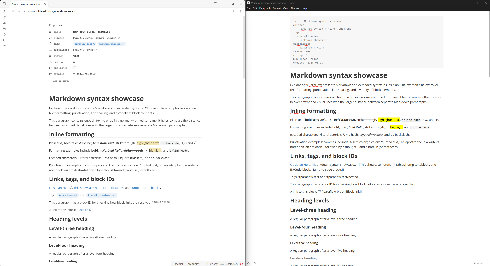

# ParaFlow

English | [中文](README.zh.md)

ParaFlow is an Obsidian plugin that tries to bring some of Typora's features and editing experience to Obsidian, including paragraph handling, list editing, math preview, table editing, etc.



> I love Typora's distraction-free experience and Obsidian's wiki links. So I wanted to build an "Obsidian with Typora inside."
>
> An unofficial imitation of Typora.

## Main features

- **Paragraph & line-breaking**: Render blank lines between paragraphs as larger gaps. (The feature that gave ParaFlow its name)
- **Lists**: Adjust list indentation as in rich-text editors.
- **Tables**: Add support for HTML tables.
- **Quotes and Callouts**: Let ParaFlow handle inserting `>` prefixes and line breaks.
- **Math**: Preview inline math and style display math blocks.
- **Code blocks**: Show line numbers and better rendering of code fences.
- **Reading and Source views**: Improve rendering and copy/paste behavior.
- **Themes**: Import Typora themes and work with Obsidian themes (hopefully).
- **Other improvements**: Better rendering of inline formatting, footnotes, images, and more.

> Each feature can be toggled individually in settings—or at least that's the idea. (There may still be issues for now)
>
> There is a [showcase vault](../../releases/tag/0.1.1) with ParaFlow installed, for your convenience.

## Installation

#### Try the showcase vault

Download `showcase-paraflow-0.1.1.zip` from the [release](../../releases/tag/0.1.1), extract it, and open the `showcase-paraflow` folder as a vault in Obsidian. It includes the matching ParaFlow build, example notes, and preset settings. The six included CSS snippets are disabled by default.

#### Manual installation

Download `main.js`, `manifest.json`, and `styles.css` from the latest release, place them in your Obsidian vault's `.obsidian/plugins/paraflow/` directory, and enable ParaFlow in Obsidian's Community plugins settings.

<details>
<summary>Build from source</summary>

Clone the repository and run the following commands (requires Node.js 20 or later and npm):

```sh
npm ci
npm run build
```

After building, locate `main.js`, `manifest.json`, and `styles.css` in the project root and copy them into the plugin directory in your Obsidian vault.

</details>

## Misc

#### Known Issues

- Development is primarily on Windows. Support for macOS, Linux, and mobile is not guaranteed yet.
- Performance on large documents may degrade.
- May be conflict with Obsidian's `Setting > Editor > Display / Readable line length`.

## Development and contributions

If you encounter any issues, feel free to open an issue or submit a PR. Please include your Obsidian version, steps to reproduce, expected and actual results, and a minimal Markdown example where possible.

```sh
npm run dev    # Development build and file watching
npm run build  # Type checking and production build
npm run lint   # Static code checks
```
