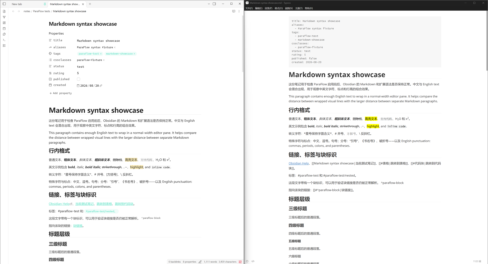

# ParaFlow

[English](README.md) | 中文

ParaFlow 是一个尝试将 Typora 中的部分功能/体验迁移到 Obsidian 中的插件，比如段落控制、list 编辑、公式编辑等。



> 我太喜欢 Typora 那种无干扰的体验了，但 Obsidian 的 wiki link 也很香，所以我想实现一个”内置 typora 的 obsidian“。
>
> 一个对 typora 的第三方仿制品（

## 主要功能

+ **段落间距**：将段落之间的空行渲染成较宽的段间距（这个功能也是 ParaFlow 名字的由来）
+ **列表**：像富文本编辑器那样调整列表的缩进
+ **表格**：增加了对 HTML 表格的支持
+ **引用和 Callout**：让 ParaFlow 来管理 ">" 和换行符的插入
+ **公式**：提供行内公式的预览与数学公式块的样式
+ **代码块**：显示行号、边界 fence 的辅助
+ **阅读/源码视图**：优化显示效果与复制粘贴
+ **主题**：支持导入 Typora 的主题，兼容 Obsidian 的主题（大概）
+ 其它：行内格式、脚注、图片等显示优化

> 每个功能都可以在设置中单独开关（至少在预期中是），但目前可能仍然存在问题
>
> [Release 中提供了已安装 ParaFlow 的 showcase 库](../../releases/tag/0.1.0)，方便直接体验。

## 安装

#### 体验 showcase 库

从 [Release](../../releases/tag/0.1.0) 下载 `showcase-paraflow-0.1.0.zip`，解压后在 Obsidian 中将 `showcase-paraflow` 文件夹作为笔记库打开。其中包含对应版本的 ParaFlow、示例笔记和预设配置。随附的 6 个 CSS snippets 默认全部关闭。

#### 手动安装

直接从最新 release 下载 `main.js` 、 `manifest.json`、`styles.css` 三个文件放入 Obsidian Vault 的 `.obsidian/plugins/paraflow/` 目录，然后在 Obsidian 的社区插件设置中启用 ParaFlow。

<details>
<summary>从源码构建</summary>

将代码拉取到本地，然后运行以下指令（需要 Node.js 20 或以上与 npm）

```
npm ci
npm run build
```

检查根目录下生成的 `main.js` 、 `manifest.json`、`styles.css` 三个文件放入 Obsidian Vault 的插件目录</details>

## 其它

#### 已知问题

+ 目前主要在 Windows 上进行开发，MacOS / Linux 以及移动端暂时不保证支持（
+ 目前在较长的文档中可能存在性能问题
+ 目前可能与 Obsidian 原生配置中的 `设置 > 编辑器 > 显示/限制行宽` 冲突

## 开发与贡献

如果有任何问题，欢迎提交 issue 或 PR，记得说明 Obsidian 版本、操作步骤、预期与实际结果，并尽量提供最小 Markdown 示例。

```sh
npm run dev    # 开发构建与文件监听
npm run build  # 类型检查与生产构建
npm run lint   # 代码静态检查
```
