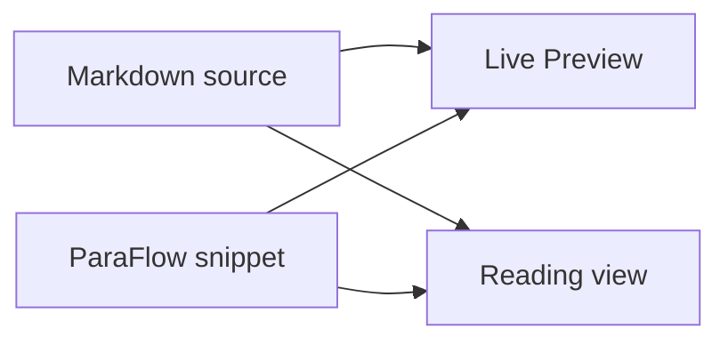

# Markdown syntax showcase

Explore how ParaFlow presents Markdown and extended syntax in Obsidian. The examples below cover text formatting, punctuation, line spacing, and a variety of block elements.

This paragraph contains enough text to wrap in a normal-width editor pane. It helps compare the distance between wrapped visual lines with the larger distance between separate Markdown paragraphs.

## Inline formatting

Plain text, **bold text**, *italic text*, ***bold italic text***, ~~strikethrough~~, ==highlighted text==, `inline code`, H~2~O and x^2^.

Formatting examples include **bold**, *italic*, ***bold italic***, ~~strikethrough~~, ~~~~, ==highlight==, and `inline code`.

Escaped characters: \*literal asterisks\*, \# a hash, \[square brackets\], and \\ a backslash.

Punctuation examples: commas, periods. A semicolon; a colon: “quoted text,” an apostrophe in a writer’s notebook, an em dash—followed by a thought—and a note in (parentheses).

## Links, tags, and block IDs

[Obsidian Help](https://help.obsidian.md), [[Markdown syntax showcase.en|This showcase note]], [[#Tables|Jump to tables]], and [[#Code blocks|Jump to code blocks]].

Tags: #paraflow-test and #paraflow-test/nested.

This paragraph has a block ID for checking how block links are resolved. ^paraflow-block

A link to this block: [[#^paraflow-block|Block link]].

## Heading levels

### Level-three heading

A regular paragraph after a level-three heading.

#### Level-four heading

A regular paragraph after a level-four heading.

##### Level-five heading

A regular paragraph after a level-five heading.

###### Level-six heading

A regular paragraph after a level-six heading.

---

## Lists

reference text

- First unordered list item
- Second unordered list item
  - Nested unordered list item
  - Another nested item
- Third unordered list item with **bold text** and `code`
1. First ordered list item
2. Second ordered list item
   1. Nested ordered list item
   2. Second nested ordered list item
3. Third ordered list item
- [x] Completed task

- [ ] Task still to do
  
  - [ ] Nested task
+ level 1
  
  + level 2
    + level 3
      + level 4

+ level 1

## Quotes and Callouts

> This is a regular quote.
> 
> A blank source line separates the second paragraph in this quote from the first.
> 
> - A list item inside the quote
> - A second list item

> [!note] ParaFlow test Callout
> Paragraphs and lists inside this Callout should retain their layout when body paragraph rules are applied.
> 
> - A Callout list item
> - Another list item

> [!warning]- Collapsible Callout
> This text helps check the title and body of a collapsed Callout.

## Code blocks

Inline TypeScript example: `const lineHeight = 1.6;`

```ts
interface Rhythm {
    lineHeight: number;
    blankLineHeight: number;
    paragraphGap: number;
}

const paraFlow: Rhythm = {
    lineHeight: 1.6,
    blankLineHeight: 0.65,
    paragraphGap: 0.8,
};
```

The plain-text code block below includes an intentional empty line:

```text
Code block line one

Code block line three after an empty code line
```

## Tables

| View | What to check | Expected result |
| --- | --- | ---: |
| Live Preview | Blank source lines | 0.65em |
| Reading view | Paragraph spacing | 0.8em |
| Source mode | Markdown content | Unchanged |

## Math

Inline math: $e^{i\pi} + 1 = 0$, and $\operatorname{gap}(p_i, p_{i+1})$.

$$
\operatorname{gap}(p_i, p_{i+1}) = 0.8\,\mathrm{em}
$$

## Footnotes

For this visual comparison, ParaFlow should preserve Markdown semantics and note content while changing the layout.[^scope]

Footnotes can also contain longer explanations.[^details]

[^scope]: Before and after a CSS test, the note's bytes and hash should remain unchanged.
[^details]: This footnote helps check indentation, line height, and paragraph spacing in the footnote list in Reading view.

## HTML and collapsible content

Inline HTML: <kbd>Ctrl</kbd> + <kbd>P</kbd>, and <u>underlined text</u>.

## Obsidian comments

The following comment is hidden in Reading view:

%% This Obsidian comment is visible in the source. %%

Regular body text continues after the comment.

## Images


## Mermaid



## Line-break variants

This sentence ends with a regular source newline.
This sentence still belongs to the same Markdown paragraph.

This sentence ends with two spaces to create a Markdown hard break.  
This sentence follows the hard break.

This sentence ends with an HTML break.<br>
This sentence follows the HTML break.

## Closing paragraphs

This first closing paragraph is short, making it easy to observe the spacing below a regular paragraph.

This second closing paragraph helps check whether paragraph spacing stays consistent after complex Markdown blocks.

This is the final paragraph. It provides one more wrapped-line sample after all complex Markdown elements have been rendered.
