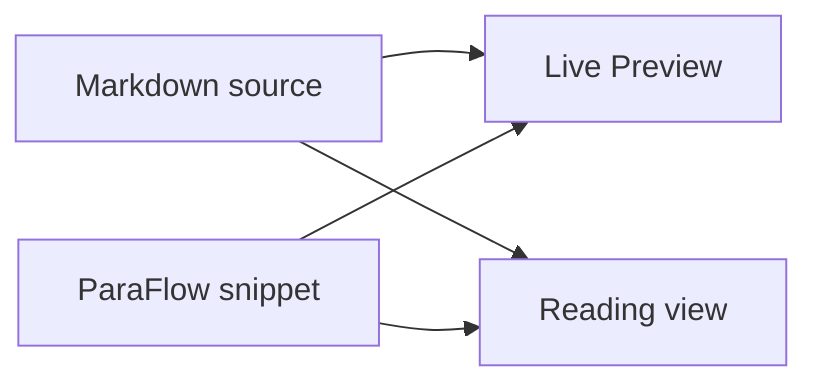

# Markdown syntax showcase

这份笔记用于检查 ParaFlow 启用前后，Obsidian 的 Markdown 和扩展语法是否保持正常。中文与 English text 会混合出现，用于观察中英文字符、标点和行高的组合效果。

This paragraph contains enough English text to wrap in a normal-width editor pane. It helps compare the distance between wrapped visual lines with the larger distance between separate Markdown paragraphs.

## 行内格式

普通文本、**粗体文本**、*斜体文本*、***粗斜体文本***、~~删除线~~、==高亮文本==、`行内代码`、H~2~O 和 x^2^。

英文示例包含 **bold**, *italic*, ***bold italic***, ~~strikethrough~~, ~~~~，==highlight==, and `inline code`.

转义字符：\*星号保持字面含义\*、\# 井号、\[方括号\]、\\ 反斜杠。

特殊字符与标点：中文，逗号。句号；分号：“引号”、《书名号》、破折号——以及 English punctuation: commas, periods, colons, and parentheses.

## 链接、标签与块标识

[Obsidian Help](https://help.obsidian.md)、[[Markdown syntax showcase.zh|当前测试笔记]]、[[#表格|跳转到表格]]、[[#代码块|跳转到代码块]]。

标签：#paraflow-test 和 #paraflow-test/nested。

这段文字带有一个块标识，可以用于验证块链接是否仍被正常解析。 ^paraflow-block

指向该块的链接：[[#^paraflow-block|块链接]]。

## 标题层级

### 三级标题

三级标题后的普通段落。

#### 四级标题

四级标题后的普通段落。

##### 五级标题

五级标题后的普通段落。

###### 六级标题

六级标题后的普通段落。

---

## 列表

reference text

- 第一个无序列表项
- 第二个无序列表项
  - 嵌套无序列表项
  - 另一个嵌套列表项
- 第三个无序列表项包含 **粗体** 和 `代码`
1. 第一个有序列表项
2. 第二个有序列表项
   1. 嵌套有序列表项
   2. 第二个嵌套有序列表项
3. 第三个有序列表项
- [x] 已完成的任务

- [ ] 尚未完成的任务
  
  - [ ] 嵌套任务
+ level 1
  
  + level 2
    + level 3
      + level 4

+ level 1

## 引用与 Callout

> 这是一段普通引用。
> 
> 引用中的第二个段落与第一个段落之间有一个空白源码行。
> 
> - 引用中的列表项
> - 第二个列表项

> [!note] ParaFlow 测试 Callout
> Callout 内部的段落和列表不应因为正文段落规则而发生意外变化。
> 
> - Callout 列表项
> - 另一个列表项

> [!warning]- 可折叠 Callout
> 这段内容用于检查折叠 Callout 的标题和正文。

## 代码块

行内 TypeScript 示例：`const lineHeight = 1.6;`

```ts
interface Rhythm {
    lineHeight: number;
    blankLineHeight: number;
    paragraphGap: number;
}

const paraFlow: Rhythm = {
    lineHeight: 1.6,
    blankLineHeight: 0.65,
    paragraphGap: 0.8,
};
```

下面的纯文本代码块包含一个有意保留的空代码行：

```text
Code block line one

Code block line three after an empty code line
```

## 表格

| 表面           | 测试目标        | 预期结果   |
| ------------ | ----------- | ------:|
| Live Preview | 空白源码行       | 0.65em |
| Reading view | 段落间距        | 0.8em  |
| Source mode  | Markdown 内容 | 不变     |

## 公式

行内公式：$e^{i\pi} + 1 = 0$，以及 $\operatorname{gap}(p_i, p_{i+1})$。

$$
\operatorname{gap}(p_i, p_{i+1}) = 0.8\,\mathrm{em}
$$

## 脚注

ParaFlow 只应修改视觉布局，不应修改 Markdown 语义或笔记内容。[^scope]

脚注也可以包含较长的说明文字。[^details]

[^scope]: 任何 CSS 测试前后，笔记文件的字节和哈希都应保持不变。
[^details]: 这条脚注用于检查 Reading view 中脚注列表的缩进、行高和段落间距。

## HTML 与折叠内容

行内 HTML：<kbd>Ctrl</kbd> + <kbd>P</kbd>，以及 <u>带下划线的文字</u>。

## Obsidian 注释

下面的注释在 Reading view 中不应显示：

%% 这是一段只在源码中可见的 Obsidian 注释。 %%

普通正文在注释后继续显示。

## 图片


## Mermaid



## 换行变体

这一句末尾只有一个普通源码换行。
这一句仍属于同一个 Markdown 段落。

这一句末尾有两个空格，用于产生 Markdown 硬换行。  
这一句位于硬换行之后。

这一句末尾使用 HTML break。<br>
这一句位于 HTML break 之后。

## 最终段落序列

这是第一个收尾段落。它比较短，用于观察普通段落下方的间距。

这是第二个收尾段落。它验证复杂 Markdown 块之后，普通段落节奏是否仍然稳定。

This is the final English paragraph. It provides one more wrapped-line sample after all complex Markdown elements have been rendered.
