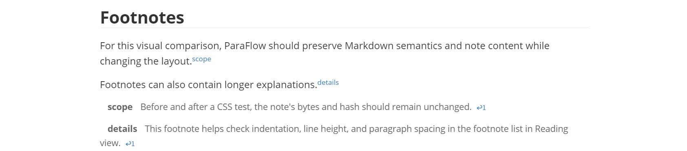

# Inline formatting, links, images, and footnotes

[Documentation](../../README.md) · [中文](../zh-CN/inline-and-media.zh.md)

In Live Preview, ParaFlow manages source visibility for inline formatting and provides editing enhancements for links, images, and footnotes.

## Use

<video src="../assets/videos/inline/inlinecode.mp4" controls=""></video>

The main changes are gray source markers such as `*` and `~`, fixes for strikethrough display in some cases, and support for subscript and superscript.

<video src="../assets/videos/inline/edit-image.mp4" controls=""></video>

Images are centered by default. Click an image to reveal its source for editing.

Footnote enhancements add links for navigating between references and definitions and adjust their formatting.

## Settings

Under **Settings → ParaFlow → Editing**, adjust these groups independently:

| Group | Main settings |
| --- | --- |
| Inline formatting & links | Plain-click behavior, subscript, superscript, and Obsidian comment display |
| Images | Reveal source at editing positions and center images |
| Footnotes | Enhanced footnote display and navigation |

Obsidian comments can remain visible or appear only while editing. Switch to Source mode to inspect link destinations, image paths, and footnote markers.

## Examples

The [Markdown syntax showcase](../../../dist/showcase/Markdown%20syntax%20showcase.en.md) includes inline formatting, links, images, and footnotes. Its images use assets supplied with the showcase; preserve those assets and relative paths when copying the note.
