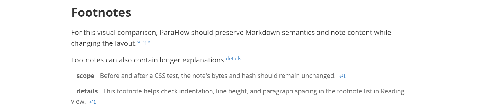

# Inline formatting, links, images, and footnotes

[Documentation](../../README.md) · [中文](../zh-CN/inline-and-media.zh.md)

In Live Preview, ParaFlow controls the display of inline formatting markers and supports subscript, superscript, link actions, image source editing, and footnote navigation.

## Use

<video src="../assets/videos/inline/inlinecode.mp4" controls=""></video>

https://github.com/user-attachments/assets/f73e8fd2-655f-4e50-b128-5c2c2cc92a65

The main changes are gray source markers such as `*` and `~`, fixes for strikethrough display in some cases, and support for subscript and superscript.

In Live Preview, a plain click edits a Wiki, Markdown, reference, automatic, email, or inline HTML link at the clicked position. Ctrl/Cmd-click opens a cross-note link in a new tab and focuses the destination; Shift-click and dragging select text. Same-note heading and block jumps stay in the current document. The same actions apply inside lists, quotes, Callouts, and supported tables. Source mode keeps native source editing, and Reading view keeps single-click navigation.

Right-click an internal link to open it in the current tab or a new tab. By default, opening a missing note shows a brief notice. You can still use an explicit **Create note** action.

<video src="../assets/videos/inline/edit-image.mp4" controls=""></video>

https://github.com/user-attachments/assets/b77afa61-4353-4d44-917e-0a778b52080f

Images are centered by default. Click an image to reveal its source for editing.

Footnote enhancements format references and definitions. In Live Preview, click a reference to edit its source, or Ctrl/Cmd-click to jump between the reference and its definition in the same note.

## Settings

Under **Settings → ParaFlow → Editing**, adjust these groups independently:

| Group | Main settings |
| --- | --- |
| Inline formatting & links | Plain-click behavior, subscript, superscript, and Obsidian comment display |
| Mouse and selection | Prevent automatic creation of link targets, enabled by default and independent of plain-click behavior |
| Images | Reveal source at editing positions and center images |
| Footnotes | Enhanced footnote display and navigation |

Choose **Edit** or **Open** for plain-click behavior. Automatic-creation protection also applies in Reading and Source modes; turn it off to restore Obsidian's creation behavior when opening a missing target. Obsidian comments can remain visible or appear only while editing.

## Examples

The [Markdown syntax showcase](../../../dist/showcase/Markdown%20syntax%20showcase.en.md) includes inline formatting, links, images, and footnotes. Its images use assets supplied with the showcase; preserve those assets and relative paths when copying the note.
