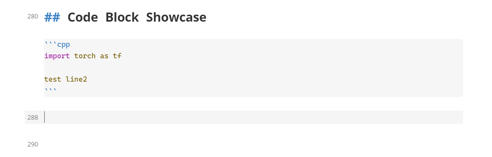
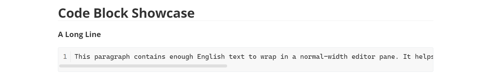
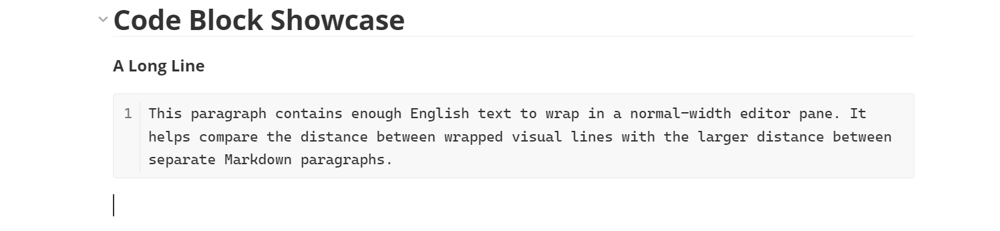
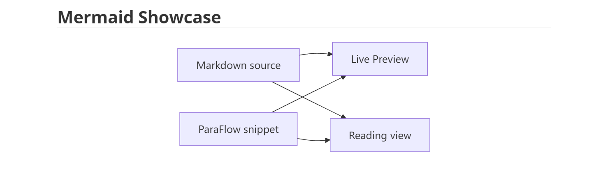
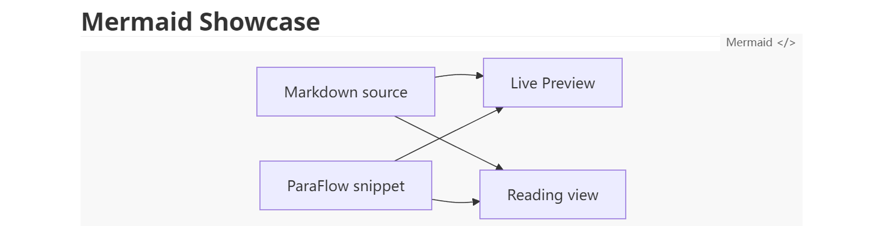
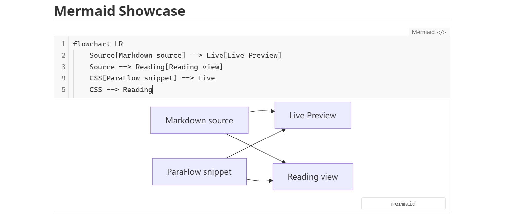

# 代码块与 Mermaid

[文档索引](../../README.zh.md) · [English](../EN/code-blocks.en.md)

ParaFlow 会为代码块提供：

+ 边界符号管理
+ 行号显示
+ 过长的行自动换行显示
+ 用来调整代码块语言的控件
+ 源码配色选择
+ 全选、复制等优化

对于 Mermaid 图提供类似 Typora 中 “点击后展开源码” 的编辑体验。

## 使用

#### 代码块

**代码块创建**

<video src="../assets/videos/codeblock/create.mp4" controls=""></video>

创建代码块以后，边界的三反引号会被隐藏，语言可以通过右下角的浮窗来修改；也可以用 `ctrl+/` 进入源码模式来修改：

源码模式中，代码块会带有深色背景以进行视觉区分

**自动折行**

正常情况下，在代码块中存在很长的一行时，会自动出现横向滚动条。在设置中打开 `编辑 > 代码块 > 自动折行` 后，则会自动显示为多行：

类似 Vscode 中的 Word Wrap。

#### Mermaid

Mermaid 图表默认提供居中显示，在鼠标悬浮时有范围提示：

在点击后则可以展开源码与实时预览：

## 设置

在 **设置 → ParaFlow → 编辑 → 代码块** 中调整自动换行、显示行号、语言输入控件的位置和语法高亮。

语言控件可以放在右上角、右下角或关闭。语法配色可以跟随 Obsidian，也可以选择 One Light、Solarized 或 Light+；后三种配色适合浅色背景。配色选择保留语言识别、代码内容与代码块背景。

**编辑 → Mermaid 图表** 控制图表增强；**复制 & 粘贴 → 粘贴时补全代码块边界** 控制相关粘贴辅助。粘贴方式见[视图与复制粘贴](views-and-clipboard.zh.md)。

## 示例

- [公式与代码块展示](../../../dist/showcase/features/Math%20and%20code%20blocks.zh.md)：语法高亮、长行、空行、缩进与复制。
- [Markdown 语法展示](../../../dist/showcase/Markdown%20syntax%20showcase.zh.md)：代码与其它语法的组合。
