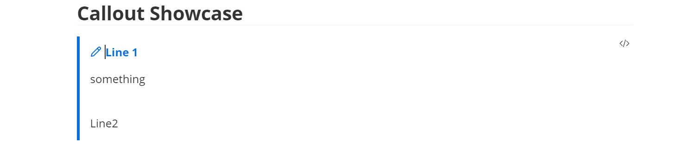
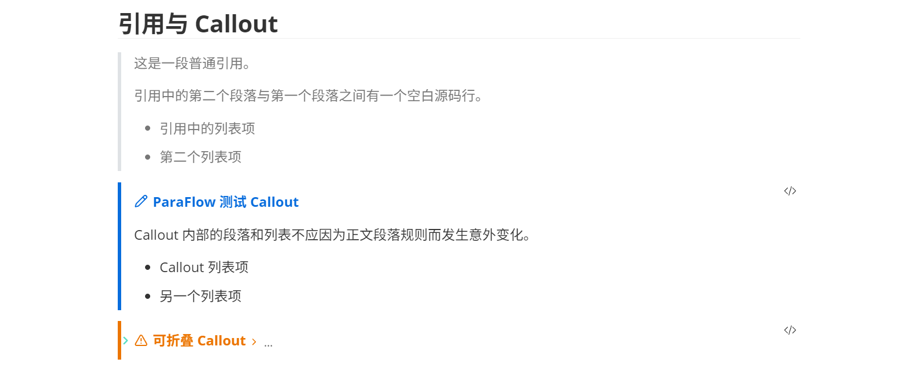
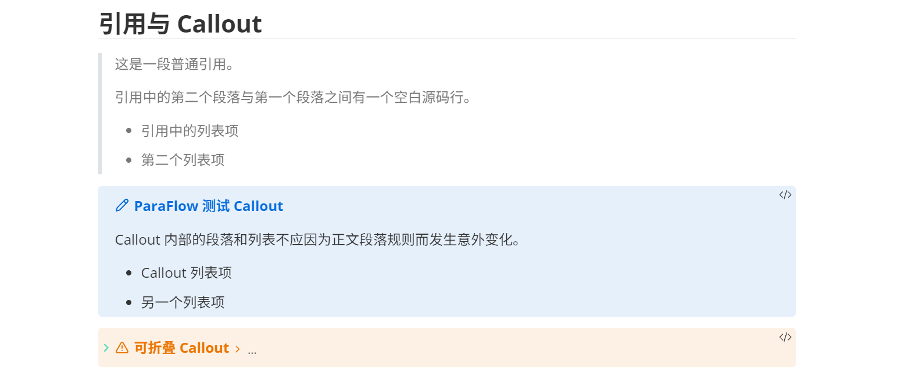

# 引用、Callout 与 HTML 块

[文档索引](../../README.zh.md) · [English](../EN/containers.en.md)

对于引用、Callout 等 “容器”，ParaFlow 提供：

+ 边界管理
+ 按键 / 快捷键（比如 enter、shift+enter、backspace 等）
+ 容器内支持段落、列表等，尽量让容器内的编辑体验与外部保持一致

各种按键操作默认是按照 Typora 中进行调整的。

对于 HTML 块，目前额外支持了 `
` 和 `
` 的渲染；HTML 表格则参考[表格的对应文档](tables.zh.md)。

## 使用

#### 引用与 Callout

**引用块（Quote）与 Callout 创建**

<video src="../assets/videos/quotes-and-callouts/create-quote.mp4" controls=""></video>

输入 `>` + `enter` 来创建引用块。

此时如果切换到 Source Mode 将第一行改为类似 `> [!note]` 的标记，就会转换为 Callout [^1]

[^1]: Callout 应该是 Obsidian 特有的语法，一般其它软件会直接显示为普通的 Quote。

**容器内编辑**

<video src="../assets/videos/quotes-and-callouts/edit-callout.mp4" controls=""></video>

容器内可以包含多个段落、嵌套列表等。

**Callout 折叠**

对于可折叠的 Callout，可以通过折叠控件展开和收起正文。

**Callout 样式**

除了上面那种 Typora 风格的 Callout，设置里也能选择使用 Obsidian 风格的 Callout。

#### HTML 支持

<video src="../assets/videos/html/details.mp4" controls=""></video>

ParaFlow 支持 `
`、`
` 等 HTML 块的源码编辑与预览；`
` 内部也可以嵌套普通 Markdown 内容（使用 `Ctrl`+`Click` 来编辑 details 块的标题）。

## 设置

在 **设置 → ParaFlow → 编辑** 中分别开关 **引用 & Callout** 与 **HTML 预览**。容器中的文字样式由当前[内容主题](themes.zh.md)控制。

在 **引用 & Callout** 设置组中，可选择 `default` 竖条样式或 `obsidian` 带背景的块样式。两种样式共用标题编辑、折叠和点击操作。

在 **HTML 预览** 设置组中，可开关 **Details 悬浮背景**。开启后，鼠标移入折叠区域时整个区域同步渐显半透明背景，保留所在 Callout 的底色。

需要检查结构时，切换到源码视图查看引用前缀、Callout 类型和 HTML 标签。编辑 HTML 内容时使用对应的 HTML 标记。

## 示例

- [列表、引用与 Callout 展示](../../../dist/showcase/features/Lists%20quotes%20and%20callouts.zh.md)：引用中的段落和列表、普通与折叠 Callout。
- [Markdown 语法展示](../../../dist/showcase/Markdown%20syntax%20showcase.zh.md)：与正文、其它 Markdown 内容的组合。
