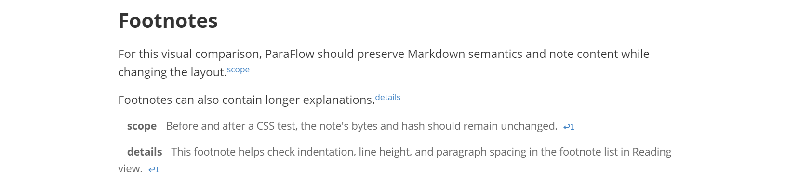

# 行内格式、链接、图片与脚注

[文档索引](../../README.zh.md) · [English](../EN/inline-and-media.en.md)

ParaFlow 控制实时预览中的行内格式标记显示，支持上下标、链接操作、图片源码编辑和脚注导航。

## 使用

<video src="../assets/videos/inline/inlinecode.mp4" controls=""></video>

https://github.com/user-attachments/assets/f73e8fd2-655f-4e50-b128-5c2c2cc92a65

主要是将显示的源码符号（比如`*`、`~` 等）改为灰色，修复部分情况下删除线的显示，增加对上下标的支持。

实时预览中，普通单击 Wiki、Markdown、引用式、自动链接、邮箱或行内 HTML 链接，在点击位置编辑源码；Ctrl/Cmd＋单击在新标签页打开跨笔记链接并聚焦目标，Shift＋单击和拖动选择文字。同页标题和块跳转留在当前文档。列表、引用、Callout 和受支持表格中的链接遵循相同操作。源码视图沿用原生源码编辑，阅读视图保持单击导航。

右键内部链接，可以选择“在当前标签页打开”或“在新的标签页打开”。默认情况下，打开尚未创建的笔记只显示简短提示，仍可使用明确的“创建笔记”操作。

<video src="../assets/videos/inline/edit-image.mp4" controls=""></video>

https://github.com/user-attachments/assets/b77afa61-4353-4d44-917e-0a778b52080f

对于图片，则是添加了 “单击显示图片源码” 的功能，并默认设置了居中。

脚注增强调整引用与定义的格式。实时预览中，单击引用编辑源码，Ctrl/Cmd＋单击在当前笔记的引用与定义之间往返。

## 设置

在 **设置 → ParaFlow → 编辑** 中分别调整：

| 分组 | 主要设置 |
| --- | --- |
| 行内格式 & 链接 | 单击链接时的操作、上下标、Obsidian 注释显示 |
| 鼠标 & 选区 | 禁止自动创建未存在的链接目标，默认开启，独立于单击操作 |
| 图片 | 进入编辑位置时显示源码、图片居中 |
| 脚注 | 脚注显示与导航增强 |

单击操作可选择“编辑”或“打开”。禁止自动创建也适用于阅读和源码视图；关闭后，打开未创建目标时恢复 Obsidian 的创建行为。Obsidian 注释可以始终显示，或仅在编辑时显示。

## 示例

[Markdown 语法展示](../../../dist/showcase/Markdown%20syntax%20showcase.zh.md) 提供行内格式、链接、图片和脚注示例。示例图片使用随展示文件提供的资源，复制笔记时应一并保留资源及相对路径。
